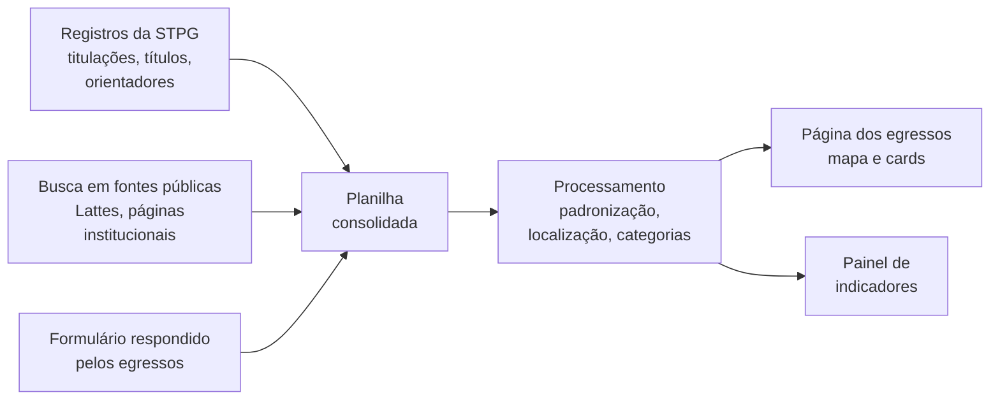

<div align="center">

# Egressos do PPGCS · 30 anos formando cientistas do solo

**Programa de Pós-Graduação em Agronomia (Ciência do Solo)**
Faculdade de Ciências Agrárias e Veterinárias (FCAV) · Unesp, Câmpus de Jaboticabal


[**Página dos egressos**](https://arpanosso.github.io/egressos-ppgcs/) ·
[**Indicadores**](https://arpanosso.github.io/egressos-ppgcs/indicadores/) ·
[**Site do programa**](https://www.fcav.unesp.br/#!/pos-graduacao/programas-pg/agronomia-ciencia-do-solo) ·
[**Dados abertos (.xlsx)**](https://arpanosso.github.io/egressos-ppgcs/indicadores/egressos-ppgcs-dados-publicos.xlsx)  ·
[**Web Scraping e processamento em R**](https://arpanosso.github.io/egressos-ppgcs/levantamento-athena/athena-scrap.html)
</div>

---

## Sobre este repositório

Este repositório reúne as páginas públicas do **mapeamento de egressos** do PPGCS, desenvolvido como parte do processo de **autoavaliação** do programa no ano em que ele completa 30 anos. Aqui estão:

- a **página dos egressos**, com mapa interativo, busca por nome, filtros por ano, curso e origem dos dados, e um card para cada titulação;
- o **painel de indicadores**, com a evolução das titulações, o destino profissional, a distribuição geográfica e a qualidade das informações levantadas;
- a **planilha de dados abertos**, com as titulações, os títulos dos trabalhos, a orientação e a atuação dos egressos, sem contatos pessoais.

As duas páginas são publicadas pelo GitHub Pages e exibidas no site oficial do programa por meio de `iframe`.

## Ficha do programa

| | |
|---|---|
| **Instituição** | Universidade Estadual Paulista Júlio de Mesquita Filho, Câmpus de Jaboticabal (UNESP-Jaboticabal) |
| **Programa** | Agronomia (Ciência do Solo) |
| **Código CAPES** | 33004102071P2 |
| **Modalidade** | Acadêmico (mestrado e doutorado) |
| **Área de avaliação** | Ciências Agrárias I |
| **Tipo de avaliação** | Avaliação de Programas |
| **Período de avaliação** | Avaliação Quadrienal 2025 (quadriênio 2021–2024) |
| **Data da publicação** | 12/01/2026 |
| **Nota** | **6**, reconhecimento de excelência com padrão internacional |

## O programa em números

| Indicador | Valor |
|---|---|
| Egressos titulados | **548** |
| Titulações (mestrado + doutorado) | **645**, de 1997 a 2026 |
| Mestres formados | **389** |
| Doutores formados | **256** |
| Estados brasileiros onde atuam | **24** |
| Países fora do Brasil | **12** (Colômbia, Costa Rica, Estados Unidos, Malta, México, Moçambique, Panamá, Paraguai, Peru, Polônia, Portugal, São Tomé e Príncipe) |
| Atuam em área relacionada à formação | **93%** dos que informaram (502 de 538) |
| Egressos com dados confirmados por eles | **151** |

> Números do levantamento de novembro de 2026. Os valores atualizados estão sempre no [painel de indicadores](https://arpanosso.github.io/egressos-ppgcs/indicadores/). Os indicadores de atuação são calculados sobre os egressos com informação disponível, e cada gráfico do painel informa a sua base de cálculo.

---

## Por que mapear egressos

### Para a CAPES

A avaliação da CAPES olha para o que o programa **produz na sociedade**, e os egressos são a expressão mais direta disso. Nas fichas de avaliação, o destino e a atuação dos egressos aparecem no quesito de **Formação**: a CAPES quer saber onde os titulados estão, se atuam na área em que foram formados e qual o impacto do trabalho deles. A **autoavaliação** é avaliada no quesito **Programa**, com atenção ao uso dos resultados no planejamento estratégico e ao envolvimento de discentes, docentes e egressos no processo.

Um mapeamento sistemático permite ao programa demonstrar, com evidências:

- **inserção profissional** e **aderência** da atuação à formação recebida;
- **nucleação**, com egressos que se tornaram docentes e pesquisadores e passaram a formar novos profissionais em outras instituições;
- **alcance regional, nacional e internacional**, com egressos em todas as regiões do país e no exterior;
- **impacto social e econômico**, em órgãos públicos, institutos de pesquisa, empresas e no setor produtivo.

### Para o PPGCS

O mapeamento transforma o acompanhamento de egressos em uma ferramenta de gestão:

- orienta o **planejamento estratégico**, a revisão curricular e a definição do perfil do egresso;
- revela **trajetórias de sucesso** que inspiram os discentes atuais;
- fortalece a **rede de ex-alunos**, abrindo caminhos para colaborações, estágios, coorientações e parcerias;
- dá visibilidade ao programa diante de candidatos, financiadores e da comunidade.

### Para a Unesp

Os egressos são parte do retorno que a universidade pública oferece à sociedade. O mapeamento contribui para:

- a **prestação de contas** sobre o investimento público na formação de mestres e doutores;
- o **planejamento institucional** e os indicadores de pós-graduação da universidade;
- a **visibilidade** da Unesp e da FCAV, com cientistas formados em Jaboticabal atuando em todo o país e no exterior.

---

## Metodologia

### Fluxo do levantamento



### 1. Fontes de dados

| Fonte | O que fornece |
|---|---|
| **Seção Técnica de Pós-Graduação (STPG)** | Nome, curso, título do trabalho, data de defesa, orientação e banca |
| **Fontes públicas** | Currículo Lattes, páginas institucionais e perfis profissionais, consultados com apoio de ferramentas de inteligência artificial e revisados pela coordenação |
| **Repositório Institucional da Unesp** | Links e títulos dos trabalhos, obtidos por coleta automatizada e conferidos com os registros da STPG |
| **Formulário aos egressos** | Atuação atual, cidade, instituição, contato, foto e autorização de publicação |
| **Equipe do levantamento** | Discentes do PPGCS que ajudaram a localizar e organizar as informações |

### 2. Origem e confiabilidade das informações

Cada card exibe um selo que informa a origem dos dados, para que o visitante saiba o grau de confirmação de cada informação.

| Selo | Origem | Significado |
|---|---|---|
| ▮▯▯ **Dados institucionais** | STPG | Somente os registros oficiais de titulação |
| ▮▮▯ **Fontes públicas, a confirmar** | Busca em fontes públicas | Informações complementadas e ainda não confirmadas pelo egresso |
| ▮▮▮ **Confirmado pelo egresso** | Formulário | Informações fornecidas pelo próprio egresso |

Redes sociais e contatos pessoais só são publicados para egressos com dados confirmados por eles.

### 3. Processamento

- **Padronização** de nomes, cursos e datas, com remoção de caracteres invisíveis e duplicidades.
- **Correspondência entre registros**, por nome, curso e ano, para que quem cursou mestrado e doutorado no programa tenha um card para cada titulação e seja contado uma única vez nos indicadores de atuação.
- **Localização geográfica** pela cidade de atuação atual, com coordenadas da base de municípios do IBGE para o Brasil e de referências oficiais para cidades no exterior. Apenas a cidade é usada, nunca o endereço; egressos da mesma cidade são distribuídos ao redor do centro do município para ficarem visíveis no mapa.
- **Classificação do destino profissional** em seis categorias: docência e pesquisa em instituições de ensino, institutos de pesquisa, setor público, setor privado, em formação (pós-graduação ou pós-doutorado) e outros. A classificação parte do cargo, da instituição e do setor informados e é revisada pela coordenação.
- **Bases de cálculo explícitas**: cada indicador informa quantos egressos têm aquela informação, evitando generalizações a partir de dados incompletos.

### 4. Privacidade e LGPD

- Só são publicadas informações profissionais e acadêmicas.
- Contatos pessoais, fotos e redes sociais dependem de autorização do egresso.
- A localização é sempre aproximada, no nível da cidade.
- Qualquer egresso pode pedir a correção ou a retirada de seus dados pelos canais do programa.
- A planilha completa, com e-mails e telefones, fica sob guarda da coordenação e **não** é publicada neste repositório. A versão aberta traz apenas dados profissionais e acadêmicos.

---

## Tecnologia

| Componente | Uso |
|---|---|
| HTML, CSS e JavaScript | Páginas estáticas, sem servidor nem banco de dados |
| [Leaflet](https://leafletjs.com/) + [Leaflet.markercluster](https://github.com/Leaflet/Leaflet.markercluster) | Mapa interativo com agrupamento de pontos |
| Esri World Light Gray Canvas | Mapa base |
| GitHub Pages | Hospedagem gratuita |
| `iframe` | Exibição no site oficial, que não executa scripts para visitantes |

## Estrutura do repositório

```
egressos-ppgcs/
├── index.html              # Página dos egressos: mapa, filtros, busca e cards
├── indicadores/
│   ├── index.html          # Painel de indicadores
│   └── egressos-ppgcs-dados-publicos.xlsx   # Dados abertos (sem contatos)
├── LICENSE
└── README.md
```

## Como atualizar

1. Atualize a planilha consolidada com novos egressos, respostas do formulário ou correções.
2. Gere novamente as páginas a partir da planilha.
3. No GitHub, substitua o `index.html` correspondente (**Add file → Upload files**) e confirme em **Commit changes**.
4. Aguarde a publicação, acompanhando a aba **Actions**, e confira as páginas com `Ctrl + F5`.

O site oficial passa a exibir a nova versão automaticamente, sem nenhuma alteração na página da Unesp.

## Leve para o seu programa

O código é aberto e pode ser adaptado por outros programas de pós-graduação. O caminho mais curto:

1. Faça um **fork** deste repositório (ou baixe os arquivos em **Code → Download ZIP**).
2. Troque os cards, a lista de cidades e os textos pelos dados do seu programa, mantendo a mesma estrutura de cada card.
3. Ative o GitHub Pages em **Settings → Pages**, escolhendo a branch `main`.
4. Exiba a página no site da sua instituição com um `iframe` apontando para o endereço gerado.

Ao reutilizar, mantenha a referência a este repositório. Antes de publicar, confira a autorização dos egressos e nunca coloque contatos pessoais no repositório.

---

## Você é egresso do PPGCS?

Ajude a contar essa história. Confira o seu card e, se quiser atualizar suas informações, responda ao formulário do programa ou entre em contato com a coordenação.

[**Formulário de Egressos**](https://forms.gle/sBt4JKDp37hb26aN6)

## Créditos

**Coordenação do PPGCS**: Prof. Dr. Alan Rodrigo Panosso
Departamento de Ciências Exatas, FCAV/Unesp, Câmpus de Jaboticabal

Levantamento realizado com a colaboração da Seção Técnica de Pós-Graduação da FCAV, dos egressos que responderam ao formulário e dos discentes da **equipe do levantamento**, futuros cientistas do solo:

- Nome do Aluno 1, mestrando do PPGCS
- Nome da Aluna 2, mestranda do PPGCS
- Nome do Aluno 3, doutorando do PPGCS

 Desenvolvimento das páginas e apoio ao levantamento em fontes públicas com auxílio de inteligência artificial (Claude, Anthropic), com revisão da coordenação.

<div align="center">

*PPGCS · FCAV/Unesp · 1996–2026*

</div>
